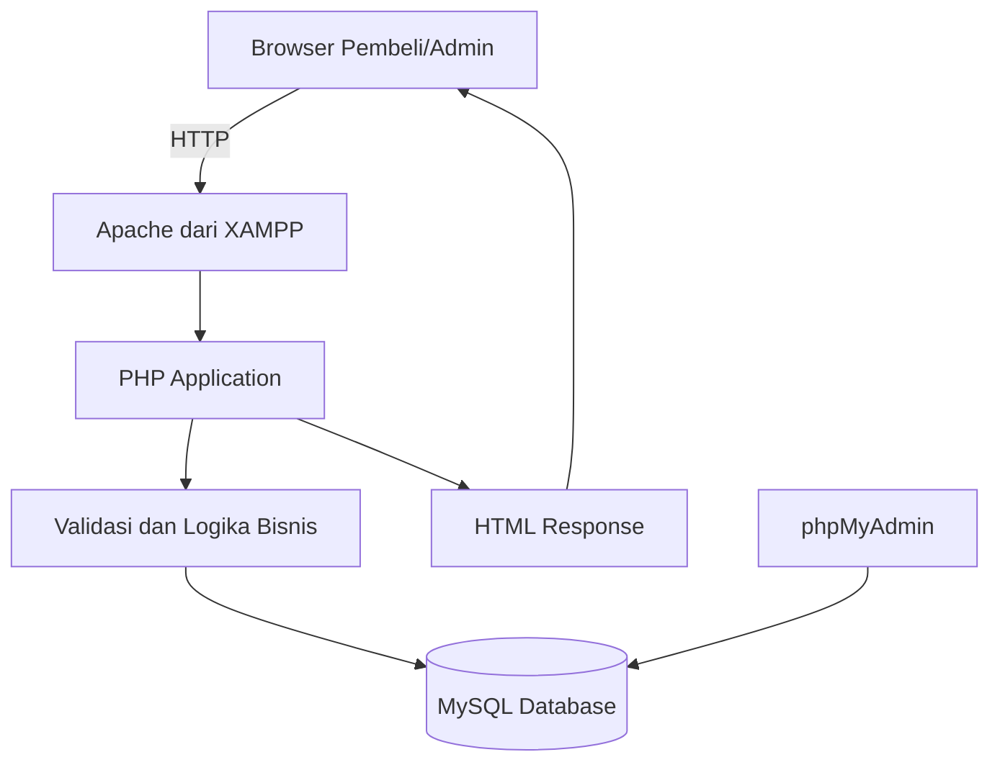
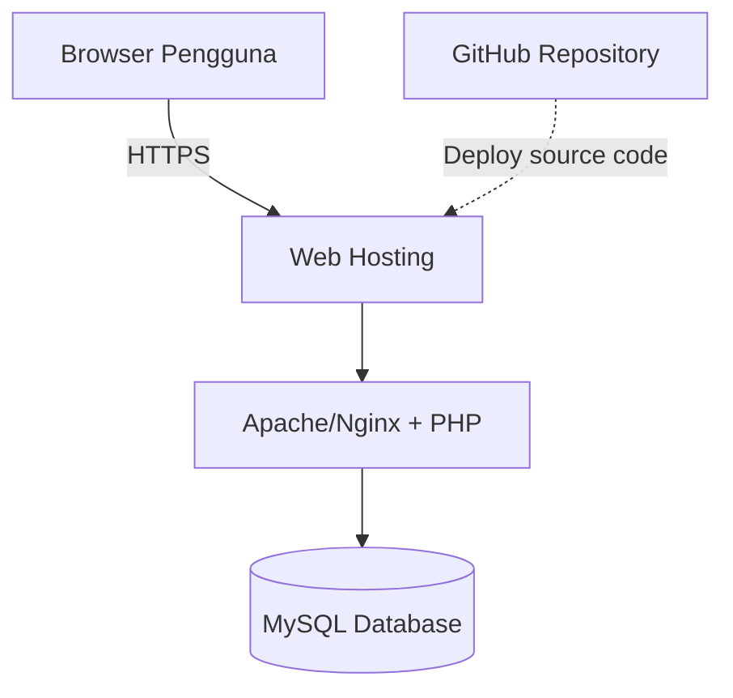
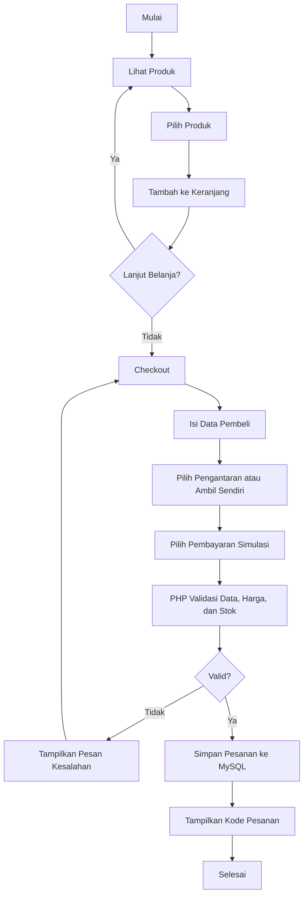
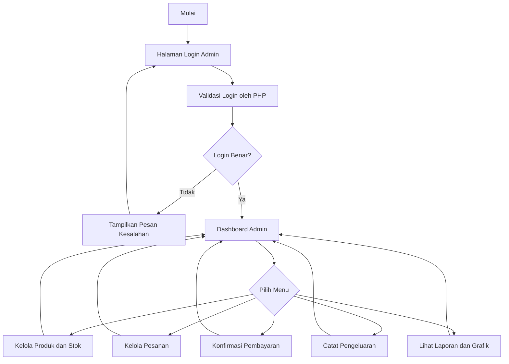
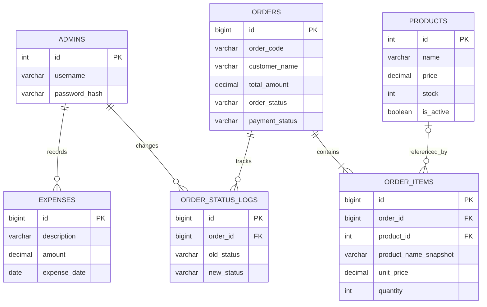

# Rice Up — Product Requirements Document (PRD) dan System Architecture

**Versi:** 2.0  
**Jenis aplikasi:** Website pemesanan rice bowl  
**Teknologi:** HTML, CSS, JavaScript, PHP, MySQL, XAMPP  
**Status:** Rancangan untuk demo dan pengembangan awal

---

## Colour Pallate yang digunakan 
#CC8780
#AD3029
#CD5252
#FEEFCD
#FFFFFF
#000000


## 1. Ringkasan Produk

Rice Up adalah website sederhana untuk bisnis rice bowl. Website memiliki dua jenis pengguna, yaitu **pembeli** dan **admin**.

Pembeli dapat melihat produk, memasukkan produk ke keranjang, mengisi data pemesanan, memilih metode pengambilan atau pengantaran, memilih metode pembayaran simulasi, dan melihat riwayat pesanannya.

Admin dapat masuk melalui halaman login, mengelola produk dan stok, memproses pesanan, mengonfirmasi atau menolak pembayaran secara manual, serta melihat ringkasan pemasukan, pengeluaran, dan keuntungan.

Website dikembangkan menggunakan PHP dan MySQL. XAMPP digunakan untuk menjalankan Apache dan MySQL di komputer lokal selama proses pengembangan. Gambar logo dan gambar produk dapat ditambahkan sendiri kemudian.

## 2. Tujuan

1. Memudahkan pembeli melihat menu Rice Up dan membuat pesanan.
2. Membantu admin mengelola produk, stok, pesanan, dan catatan keuangan.
3. Menyimpan data secara terstruktur dalam database MySQL.
4. Menjadi dasar pengembangan website yang kelak dapat dipasang pada hosting yang mendukung PHP dan MySQL.

## 3. Ruang Lingkup

### Fitur yang termasuk

- Halaman utama dan daftar produk.
- Detail produk, gambar, deskripsi, harga, dan stok.
- Keranjang belanja.
- Checkout dengan validasi data pembeli.
- Pilihan pengantaran atau ambil sendiri.
- Pilihan pembayaran simulasi.
- Riwayat pesanan pembeli.
- Login admin.
- CRUD produk: tambah, lihat, ubah, dan hapus.
- Pengelolaan stok.
- Daftar pesanan dan perubahan status.
- Konfirmasi atau penolakan pembayaran secara manual.
- Pencatatan pemasukan dan pengeluaran.
- Ringkasan pendapatan, biaya, dan keuntungan.
- Grafik pengeluaran harian dan bulanan.
- Penyimpanan data menggunakan MySQL.

### Tidak termasuk pada versi awal

- Pembayaran online sungguhan melalui payment gateway.
- Integrasi kurir atau pelacakan pengiriman otomatis.
- Notifikasi WhatsApp otomatis.
- Aplikasi mobile native.
- Multi-cabang dan manajemen banyak gudang.

## 4. Jenis Pengguna

### 4.1 Pembeli

Pembeli dapat:
- Membuka halaman utama.
- Melihat daftar dan detail produk.
- Menambahkan produk ke keranjang dan mengubah jumlahnya.
- Mengisi nama, nomor telepon, dan informasi pemesanan.
- Memilih pengantaran atau ambil sendiri.
- Memilih metode pembayaran yang tersedia pada demo.
- Mengirim pesanan dan memperoleh kode pesanan.
- Melihat status pesanan dan riwayat pesanan.

**Catatan akses riwayat:** Jika pembeli belum memiliki akun, riwayat dapat ditampilkan berdasarkan kode pesanan dan nomor telepon yang diverifikasi secara sederhana. Untuk sistem publik yang lebih aman, sebaiknya gunakan akun pembeli atau mekanisme verifikasi yang memadai.

### 4.2 Admin

Admin dapat:
- Login menggunakan username dan password.
- Melihat ringkasan dashboard.
- Menambah, mengubah, dan menghapus produk.
- Mengubah stok produk.
- Melihat pesanan masuk dan detailnya.
- Mengubah status pesanan sesuai alur yang diizinkan.
- Mengonfirmasi atau menolak pembayaran secara manual.
- Mencatat pengeluaran.
- Melihat laporan pemasukan, pengeluaran, dan keuntungan.
- Melihat grafik pengeluaran harian dan bulanan.

## 5. Daftar Produk Awal

Gambar produk masih menggunakan placeholder dan dapat diganti kemudian.

| Nama produk | Deskripsi awal | Harga |
|---|---|---:|
| Nasi Ayam Lava | Rice bowl ayam dengan saus pedas khas | Ditentukan pemilik |
| Nasi Ayam Sambal Matah | Rice bowl ayam dengan sambal matah | Ditentukan pemilik |
| Nasi Ayam Katsu Cabe Hijau | Rice bowl ayam katsu dengan saus cabe hijau | Ditentukan pemilik |

Harga, deskripsi akhir, gambar, dan stok awal perlu diisi sebelum website digunakan.

## 6. Alur Utama Pembeli

1. Pembeli membuka halaman utama.
2. Website mengambil daftar produk aktif dari database.
3. Pembeli melihat detail produk dan memilih jumlah.
4. Produk dimasukkan ke keranjang pada browser. Keranjang boleh disimpan sementara di `sessionStorage` atau `localStorage`; data harga dan stok tetap harus divalidasi ulang oleh PHP ketika checkout.
5. Pembeli membuka checkout dan mengisi nama, nomor telepon, metode pemenuhan pesanan, serta alamat jika memilih pengantaran.
6. Pembeli memilih metode pembayaran simulasi.
7. Browser mengirim data checkout ke PHP melalui metode POST.
8. PHP memvalidasi input, memeriksa stok terkini, menghitung ulang total harga dari database, dan membuat pesanan.
9. PHP menyimpan pesanan dan detail item dalam transaksi database serta mengurangi stok dengan aman.
10. Website menampilkan kode pesanan dan status awal.

**Penting:** Jangan mempercayai total harga yang dikirim dari browser. Server harus menghitung ulang harga berdasarkan data produk di database.

## 7. Alur Utama Admin

1. Admin membuka halaman login.
2. PHP memeriksa username dan password menggunakan hash password yang tersimpan.
3. Jika benar, server membuat sesi login.
4. Admin masuk ke dashboard.
5. Admin mengelola produk, stok, pesanan, dan catatan keuangan.
6. Setiap aksi admin diperiksa kembali oleh PHP untuk memastikan sesi dan hak akses valid.
7. Dashboard menampilkan laporan yang dihitung dari data transaksi di MySQL.

## 8. Status Pesanan dan Pembayaran

### Status pesanan

- `pending` — pesanan baru diterima.
- `confirmed` — pesanan diterima admin.
- `processing` — pesanan sedang disiapkan.
- `ready` — pesanan siap diambil atau dikirim.
- `completed` — pesanan selesai.
- `rejected` — pesanan ditolak.
- `cancelled` — pesanan dibatalkan.

### Status pembayaran

- `unpaid` — belum dibayar.
- `awaiting_confirmation` — pembeli menyatakan pembayaran sudah dilakukan dan menunggu pemeriksaan.
- `paid` — pembayaran telah dikonfirmasi admin.
- `rejected` — pembayaran ditolak.
- `refunded` — dana dikembalikan, jika proses pengembalian memang diterapkan.

Status pesanan dan pembayaran harus dipisahkan. Perubahan status hanya boleh dilakukan sesuai aturan bisnis, dan setiap perubahan penting perlu mencatat waktu serta admin yang melakukannya.

## 9. Aturan Bisnis

1. Hanya produk aktif yang dapat dipesan.
2. Jumlah item harus bilangan bulat positif.
3. PHP menghitung ulang harga dan subtotal dari database.
4. Checkout harus gagal jika stok tidak cukup.
5. Pembuatan pesanan dan pengurangan stok dilakukan dalam satu transaksi database agar data tetap konsisten.
6. Stok tidak boleh menjadi negatif.
7. Penolakan atau pembatalan pesanan mengembalikan stok hanya jika stok sebelumnya memang sudah dikurangi. Proses pengembalian harus terlindungi agar tidak terjadi dua kali.
8. Pengeluaran dicatat terpisah dari pembayaran pembeli.
9. Pemasukan sebaiknya dihitung dari pembayaran yang telah dikonfirmasi, bukan hanya dari pesanan yang dibuat.
10. Keuntungan sederhana = pemasukan yang diakui − pengeluaran yang dicatat. Untuk laporan laba yang akurat, biaya bahan baku dan biaya lain perlu dicatat secara konsisten.
11. Admin wajib login untuk mengakses halaman admin dan endpoint pengelolaan data.
12. Semua input dari pengguna harus divalidasi di server.
13. Query database menggunakan prepared statements, misalnya melalui PDO atau MySQLi.
14. Aksi yang mengubah data harus menggunakan metode POST dan perlindungan CSRF.

## 10. Kebutuhan Fungsional

| ID | Kebutuhan |
|---|---|
| FR-01 | Sistem menampilkan halaman utama Rice Up. |
| FR-02 | Sistem mengambil daftar produk dari MySQL. |
| FR-03 | Sistem menampilkan gambar, nama, deskripsi, harga, dan ketersediaan produk. |
| FR-04 | Pembeli dapat menambah produk ke keranjang. |
| FR-05 | Pembeli dapat mengubah jumlah dan menghapus item dari keranjang. |
| FR-06 | Sistem memvalidasi data checkout. |
| FR-07 | Sistem memvalidasi harga dan stok di server. |
| FR-08 | Sistem menyimpan pesanan dan detail item ke database. |
| FR-09 | Sistem mengurangi stok secara konsisten saat pesanan dibuat sesuai kebijakan stok. |
| FR-10 | Pembeli dapat memilih pengantaran atau ambil sendiri. |
| FR-11 | Pembeli dapat memilih metode pembayaran simulasi. |
| FR-12 | Sistem menampilkan kode dan status pesanan. |
| FR-13 | Pembeli dapat melihat status/riwayat pesanan melalui mekanisme akses yang ditentukan. |
| FR-14 | Admin dapat login dan logout. |
| FR-15 | Sistem membatasi halaman admin bagi pengguna yang belum login. |
| FR-16 | Admin dapat menambah produk. |
| FR-17 | Admin dapat melihat produk. |
| FR-18 | Admin dapat mengubah produk. |
| FR-19 | Admin dapat menonaktifkan atau menghapus produk sesuai aturan data. |
| FR-20 | Admin dapat mengubah stok. |
| FR-21 | Admin dapat melihat daftar dan detail pesanan. |
| FR-22 | Admin dapat memperbarui status pesanan. |
| FR-23 | Admin dapat mengonfirmasi atau menolak pembayaran secara manual. |
| FR-24 | Sistem menyimpan catatan perubahan status yang penting. |
| FR-25 | Admin dapat mencatat pengeluaran. |
| FR-26 | Admin dapat melihat laporan pemasukan. |
| FR-27 | Admin dapat melihat laporan pengeluaran harian dan bulanan. |
| FR-28 | Admin dapat melihat ringkasan keuntungan. |
| FR-29 | Dashboard dapat menampilkan grafik pengeluaran. |
| FR-30 | Sistem memvalidasi input dan menampilkan pesan kesalahan yang mudah dipahami. |

## 11. Kebutuhan Nonfungsional

1. **Keamanan:** password disimpan dengan `password_hash()` dan diperiksa dengan `password_verify()`, bukan teks biasa.
2. **Otorisasi:** setiap halaman dan endpoint admin memeriksa sesi dan peran admin di sisi server.
3. **Keamanan query:** gunakan prepared statements untuk mengurangi risiko SQL injection.
4. **Validasi:** validasi dilakukan di browser untuk kenyamanan dan di PHP untuk keamanan.
5. **Konsistensi data:** operasi checkout menggunakan transaksi MySQL.
6. **Kegunaan:** halaman harus mudah dipahami pada desktop dan ponsel.
7. **Pemeliharaan:** pisahkan konfigurasi database, logika, dan tampilan.
8. **Privasi:** kumpulkan data pembeli secukupnya dan jangan menampilkan data pribadi kepada pengguna lain.
9. **Kegagalan:** sistem memberikan pesan yang jelas tanpa menampilkan detail error database kepada pembeli.
10. **Backup:** database perlu dicadangkan secara berkala jika website digunakan sungguhan.

## 12. Arsitektur Sistem

### 12.1 Arsitektur pengembangan lokal



### 12.2 Arsitektur setelah di-hosting



GitHub digunakan untuk menyimpan dan mengelola kode. **GitHub Pages tidak dapat menjalankan PHP atau menyediakan database MySQL.** Untuk membuat website PHP dapat diakses secara online, pilih hosting yang mendukung PHP dan MySQL. XAMPP hanya diperlukan saat pengembangan lokal, bukan sebagai server yang harus terus menyala setelah website dipasang di hosting.

## 13. Diagram Alur Pembeli



## 14. Diagram Alur Admin



## 15. Struktur Folder yang Disarankan

```text
rice-up/
├── app/
│   ├── config/
│   │   └── database.php
│   ├── helpers/
│   │   └── functions.php
│   └── middleware/
│       └── admin_auth.php
├── public/
│   ├── index.php
│   ├── products.php
│   ├── product-detail.php
│   ├── cart.php
│   ├── checkout.php
│   ├── order-success.php
│   ├── order-status.php
│   ├── assets/
│   │   ├── css/
│   │   │   └── style.css
│   │   ├── js/
│   │   │   └── app.js
│   │   └── images/
│   │       ├── logo-placeholder.png
│   │       ├── nasi-ayam-lava-placeholder.png
│   │       ├── nasi-ayam-sambal-matah-placeholder.png
│   │       └── nasi-ayam-katsu-cabe-hijau-placeholder.png
│   └── admin/
│       ├── login.php
│       ├── logout.php
│       ├── index.php
│       ├── products.php
│       ├── product-form.php
│       ├── orders.php
│       ├── order-detail.php
│       ├── expenses.php
│       └── reports.php
├── database/
│   └── rice_up.sql
└── README.md
```

**Catatan:** Folder `public` menjadi document root jika konfigurasi hosting memungkinkan. Untuk setup XAMPP sederhana, proyek dapat diletakkan di `htdocs/rice-up/`, tetapi file konfigurasi dan file internal sebaiknya tidak dapat diakses langsung dari browser. Jangan menyimpan password database atau rahasia lain di repository publik.

## 16. Rancangan Database Konseptual

### 16.1 Tabel `admins`

| Kolom | Tipe | Keterangan |
|---|---|---|
| id | INT, PK, AUTO_INCREMENT | ID admin |
| username | VARCHAR(50), UNIQUE | Nama login |
| password_hash | VARCHAR(255) | Hasil `password_hash()` |
| created_at | TIMESTAMP | Waktu dibuat |

### 16.2 Tabel `products`

| Kolom | Tipe | Keterangan |
|---|---|---|
| id | INT, PK, AUTO_INCREMENT | ID produk |
| name | VARCHAR(150) | Nama produk |
| description | TEXT | Deskripsi produk |
| price | DECIMAL(12,2) | Harga |
| stock | INT | Stok tersedia |
| image_path | VARCHAR(255), NULL | Lokasi file gambar |
| is_active | TINYINT(1) | Status aktif |
| created_at | TIMESTAMP | Waktu dibuat |
| updated_at | TIMESTAMP | Waktu diperbarui |

### 16.3 Tabel `orders`

| Kolom | Tipe | Keterangan |
|---|---|---|
| id | BIGINT, PK, AUTO_INCREMENT | ID internal |
| order_code | VARCHAR(30), UNIQUE | Kode pesanan untuk pembeli |
| customer_name | VARCHAR(120) | Nama pembeli |
| customer_phone | VARCHAR(30) | Nomor telepon |
| fulfillment_method | ENUM('delivery','pickup') | Pengantaran atau ambil sendiri |
| delivery_address | TEXT, NULL | Alamat jika pengantaran |
| notes | TEXT, NULL | Catatan pesanan |
| subtotal | DECIMAL(12,2) | Total item |
| delivery_fee | DECIMAL(12,2) | Biaya pengantaran |
| total_amount | DECIMAL(12,2) | Total pesanan |
| order_status | VARCHAR(30) | Status pesanan |
| payment_method | VARCHAR(40) | Metode pembayaran simulasi |
| payment_status | VARCHAR(30) | Status pembayaran |
| created_at | TIMESTAMP | Waktu dibuat |
| updated_at | TIMESTAMP | Waktu diperbarui |

### 16.4 Tabel `order_items`

| Kolom | Tipe | Keterangan |
|---|---|---|
| id | BIGINT, PK, AUTO_INCREMENT | ID detail |
| order_id | BIGINT, FK | Relasi ke pesanan |
| product_id | INT, FK, NULL | Relasi ke produk jika masih tersedia |
| product_name_snapshot | VARCHAR(150) | Nama produk saat dipesan |
| unit_price | DECIMAL(12,2) | Harga saat dipesan |
| quantity | INT | Jumlah |
| line_total | DECIMAL(12,2) | Harga dikali jumlah |

Snapshot nama dan harga penting agar detail pesanan lama tetap benar meskipun nama atau harga produk berubah.

### 16.5 Tabel `expenses`

| Kolom | Tipe | Keterangan |
|---|---|---|
| id | BIGINT, PK, AUTO_INCREMENT | ID pengeluaran |
| description | VARCHAR(200) | Keterangan |
| category | VARCHAR(80) | Kategori pengeluaran |
| amount | DECIMAL(12,2) | Jumlah biaya |
| expense_date | DATE | Tanggal pengeluaran |
| created_by | INT, FK | Admin yang mencatat |
| created_at | TIMESTAMP | Waktu dicatat |

### 16.6 Tabel `order_status_logs` (disarankan)

| Kolom | Tipe | Keterangan |
|---|---|---|
| id | BIGINT, PK, AUTO_INCREMENT | ID log |
| order_id | BIGINT, FK | Pesanan terkait |
| old_status | VARCHAR(30), NULL | Status sebelumnya |
| new_status | VARCHAR(30) | Status baru |
| changed_by | INT, FK, NULL | Admin yang mengubah |
| note | TEXT, NULL | Catatan perubahan |
| created_at | TIMESTAMP | Waktu perubahan |

### Relasi antartabel



## 17. Keamanan Dasar

- Gunakan `password_hash($password, PASSWORD_DEFAULT)` ketika membuat atau mengganti password admin.
- Gunakan `password_verify()` saat login.
- Setelah login berhasil, regenerasi ID sesi dengan `session_regenerate_id(true)`.
- Gunakan prepared statements dengan PDO atau MySQLi.
- Escape teks yang ditampilkan ke HTML, misalnya dengan `htmlspecialchars()`.
- Terapkan token CSRF pada form yang mengubah data.
- Jangan menyimpan password dalam teks biasa.
- Jangan mengandalkan penyembunyian tombol untuk membatasi akses; periksa sesi dan izin di setiap endpoint.
- Jangan unggah file rahasia, dump database berisi data pribadi, atau kredensial ke GitHub.
- Gunakan HTTPS saat website online.
- Batasi tipe dan ukuran file jika admin diperbolehkan mengunggah gambar.
- Untuk sistem nyata, buat akun database dengan izin minimum yang diperlukan.

## 18. Perhitungan Laporan

- **Subtotal pesanan** = jumlah dari harga saat pemesanan × kuantitas setiap item.
- **Total pesanan** = subtotal + biaya pengantaran − diskon, jika fitur tersebut digunakan.
- **Pemasukan terkonfirmasi** = total pembayaran dari pesanan dengan status pembayaran `paid`, sesuai kebijakan pencatatan.
- **Total pengeluaran** = jumlah pengeluaran yang tercatat pada periode yang dipilih.
- **Selisih kas sederhana** = pemasukan terkonfirmasi − pengeluaran tercatat.

Angka terakhir adalah ringkasan sederhana, belum tentu sama dengan laba akuntansi. Agar laba lebih akurat, catat biaya bahan baku, kemasan, listrik, transportasi, dan biaya operasional lain secara konsisten. Grafik dapat dikelompokkan per tanggal untuk laporan harian dan per bulan untuk laporan bulanan.

## 19. Menjalankan Proyek di XAMPP

1. Instal XAMPP yang menyertakan Apache, PHP, dan MySQL/MariaDB.
2. Jalankan Apache dan MySQL dari XAMPP Control Panel.
3. Buat folder proyek, misalnya `C:\xampp\htdocs\rice-up\`.
4. Buka `http://localhost/phpmyadmin/` di browser.
5. Buat database bernama `rice_up`, lalu impor file `database/rice_up.sql`.
6. Sesuaikan pengaturan koneksi pada `app/config/database.php`.
7. Buka website melalui `http://localhost/rice-up/public/` atau sesuaikan struktur folder dengan konfigurasi Apache.
8. Buat akun admin awal melalui proses setup yang aman; jangan menanam password teks biasa di source code.
9. Uji checkout, validasi stok, status pesanan, dan laporan sebelum dipakai.

Contoh koneksi menggunakan PDO:

```php
<?php
$host = '127.0.0.1';
$dbname = 'rice_up';
$username = 'root';
$password = ''; // Default XAMPP lokal sering kosong; jangan gunakan konfigurasi ini di hosting.

$dsn = "mysql:host={$host};dbname={$dbname};charset=utf8mb4";

$options = [
    PDO::ATTR_ERRMODE => PDO::ERRMODE_EXCEPTION,
    PDO::ATTR_DEFAULT_FETCH_MODE => PDO::FETCH_ASSOC,
    PDO::ATTR_EMULATE_PREPARES => false,
];

$pdo = new PDO($dsn, $username, $password, $options);
```

Simpan konfigurasi produksi di environment/config rahasia hosting, bukan di repository publik. Konfigurasi di atas hanya contoh pengembangan lokal dan harus disesuaikan dengan instalasi masing-masing.

## 20. Hosting dan GitHub

- GitHub digunakan untuk version control dan menyimpan source code.
- GitHub Pages hanya untuk website statis dan tidak menjalankan PHP atau MySQL.
- Untuk hosting online, gunakan layanan yang mendukung versi PHP yang sesuai dan database MySQL.
- Konfigurasikan database, username, password, dan host database pada hosting.
- Aktifkan HTTPS.
- Jangan mengunggah password database atau data pembeli ke repository.
- Setelah deploy, XAMPP di komputer lokal tidak harus terus menyala; XAMPP tetap berguna untuk pengembangan dan pengujian lokal.

## 21. Kriteria Penerimaan

- Pembeli dapat melihat tiga produk Rice Up beserta informasi dasarnya.
- Keranjang dapat ditambah, diubah, dan dihapus.
- Checkout menolak data yang tidak valid.
- Total harga dihitung di server dan stok diperiksa sebelum pesanan disimpan.
- Pesanan tersimpan di MySQL dan memiliki kode pesanan.
- Stok tidak menjadi negatif ketika dua checkout terjadi berdekatan.
- Admin dapat login dan mengelola produk.
- Halaman admin tidak bisa dibuka tanpa sesi admin yang valid.
- Admin dapat melihat pesanan dan memperbarui statusnya.
- Konfirmasi pembayaran dicatat.
- Pengeluaran dapat ditambahkan dan muncul dalam laporan periode yang sesuai.
- Grafik harian dan bulanan menampilkan data dari database.
- Gambar produk dapat diganti tanpa mengubah logika pemesanan.

## 22. Tahapan Pengerjaan

1. Siapkan XAMPP, folder proyek, database, dan koneksi PHP.
2. Buat skema MySQL dan data awal tiga produk.
3. Buat tampilan halaman utama dan daftar produk.
4. Buat keranjang dan checkout dengan validasi server.
5. Buat penyimpanan pesanan, detail pesanan, dan pengelolaan stok.
6. Buat login admin dan proteksi sesi.
7. Buat CRUD produk dan halaman manajemen pesanan.
8. Buat konfirmasi pembayaran dan catatan status.
9. Buat pencatatan pengeluaran dan laporan.
10. Uji keamanan, validasi, dan alur pemesanan.
11. Simpan source code ke GitHub tanpa kredensial rahasia.
12. Jika dibutuhkan, deploy ke hosting yang mendukung PHP dan MySQL.

## 23. Keputusan yang Masih Perlu Diisi

- Harga setiap produk.
- Stok awal masing-masing produk.
- Biaya pengantaran dan area layanan.
- Metode pembayaran simulasi yang ditampilkan.
- Apakah pembeli perlu akun atau cukup menggunakan kode pesanan.
- Username admin awal dan prosedur pembuatan password.
- Kategori pengeluaran yang akan digunakan.
- Logo dan foto asli produk.

---

**Kesimpulan:** Rice Up dirancang sebagai website PHP dan MySQL dengan XAMPP untuk pengembangan lokal. PHP menangani logika dan validasi di sisi server, MySQL menyimpan data permanen, dan HTML/CSS/JavaScript mengatur tampilan serta interaksi. GitHub dipakai untuk menyimpan source code, sedangkan website online harus dipasang pada hosting yang mendukung PHP dan MySQL.
